# CDS – Security & Infrastructure

**Case: Kvist & Bjælke ApS**

**Group members:** Maria, Jakub and Valerie

## Introduction

Kvist & Bjælke ApS wants to develop a new login platform with a strong focus on security and modernise its existing IT infrastructure.

The purpose of this project is to develop a secure login platform and establish the infrastructure needed to host and access the application.

The project is divided into two main parts:

- **CDS.security:** Development and security assessment of the login platform.

- **CDS.infrastructure:** Network design, IP planning, virtualisation and deployment of the login platform.

The two parts are connected because the login platform developed in CDS.security must be deployed on the server infrastructure established in CDS.infrastructure.

## Part 1 – CDS.security

### 1.1 Development of the Login Platform

The login platform is developed as a web-based application using React, TypeScript and ASP.NET Core.

The backend handles authentication, user management and communication with the database, while the frontend provides the user interface.

The main requirements are:

- Users can log in using a username and password.

- The system uses role-based authorisation.

- Passwords are securely hashed and never stored as plaintext.

- Users have different permissions depending on their role.

- The application can run inside a Docker container.

#### Technologies

| **Technology**        | **Purpose**          |
|-----------------------|----------------------|
| C# / ASP.NET Core     | Backend API          |
| React                 | Frontend             |
| TypeScript            | Frontend development |
| SQL Server            | Database             |
| Entity Framework Core | Database access      |
| JWT                   | Authentication       |
| Docker                | Deployment           |

### 1.2 Authentication and Security

#### Login and Authentication

Users authenticate using their username and password.

When a user logs in, the backend verifies the submitted password against the stored password hash.

After successful authentication, the backend generates a JSON Web Token (JWT). The token is used to authenticate requests to protected API endpoints.

This means that users do not need to send their password with every request.

#### Password Hashing

Passwords are never stored as readable text in the database.

Instead, the application uses ASP.NET Core's password hashing functionality to generate a password hash before storing it.

When a user logs in, the submitted password is verified against the stored hash.

This is important because even if an unauthorised person gains access to the database, they cannot simply read the users' original passwords.

#### User Roles and Permissions

The application uses three roles:

| **Role**  | **Permissions**                                                   |
|-----------|-------------------------------------------------------------------|
| User      | Can read and view users in the user table.                        |
| Superuser | Can create, read, update and delete regular users.                |
| Admin     | Can create, read, update and delete users, superusers and admins. |

The role system ensures that users only have access to the functions they are authorised to use.

#### User Creation and Temporary Passwords

User accounts are created by an Admin through the user management system.

When the Admin creates a new account, the backend automatically generates a secure temporary password.

The temporary password is shown to the Admin after the account has been created. Only the hashed version is stored in the database.

New accounts are marked with a MustChangePassword flag, which indicates that the user must choose a new password when logging in for the first time.

#### First-Time Password Change

When a new user logs in for the first time, they must create their own personal password before continuing.

The process is:

1.  The Admin creates the user's account.

2.  The backend generates a temporary password.

3.  The Admin gives the temporary password to the new user.

4.  The user logs in using their username and temporary password.

5.  The user is required to create a new personal password.

6.  The new password is hashed and stored in the database.

#### Why is this important?

The temporary password is only intended to give the user initial access to the system. By requiring a password change, the user gets control over their own permanent credentials.

It also reduces the risk of temporary passwords being reused or remaining active indefinitely. The Admin does not need to know or choose the user's permanent password.

### 1.3 Screenshots – CDS.security

The following screenshots demonstrate the main functionality of the login platform.

#### Login Page

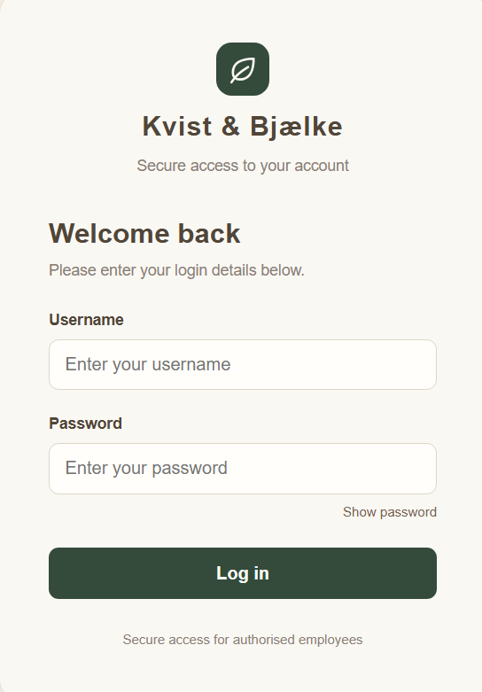

#### User Management

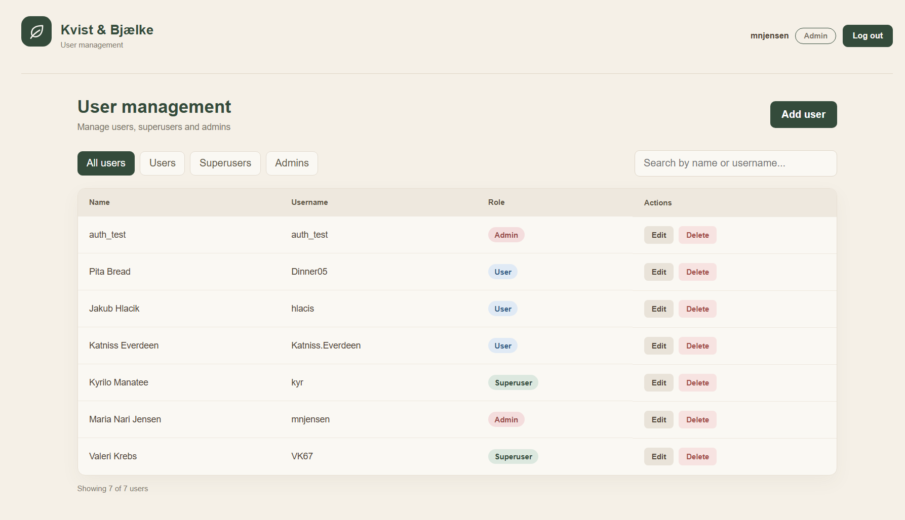

#### Create User

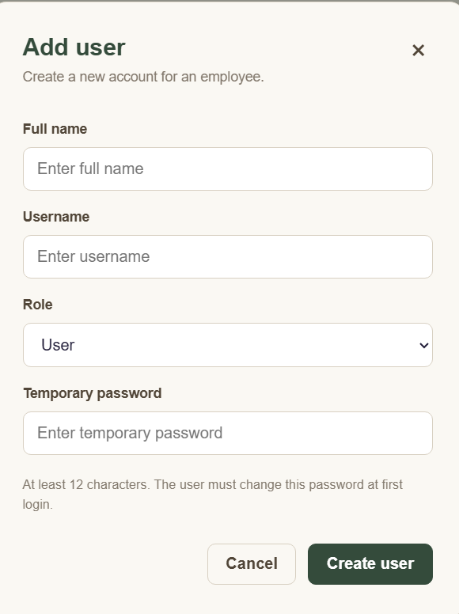

#### First-Time Login: Choose a New Password

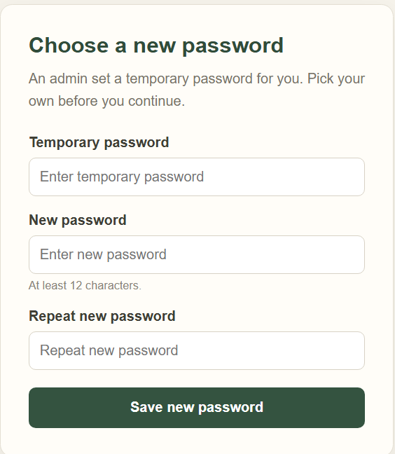

#### Role-Based Access (User and Superuser)

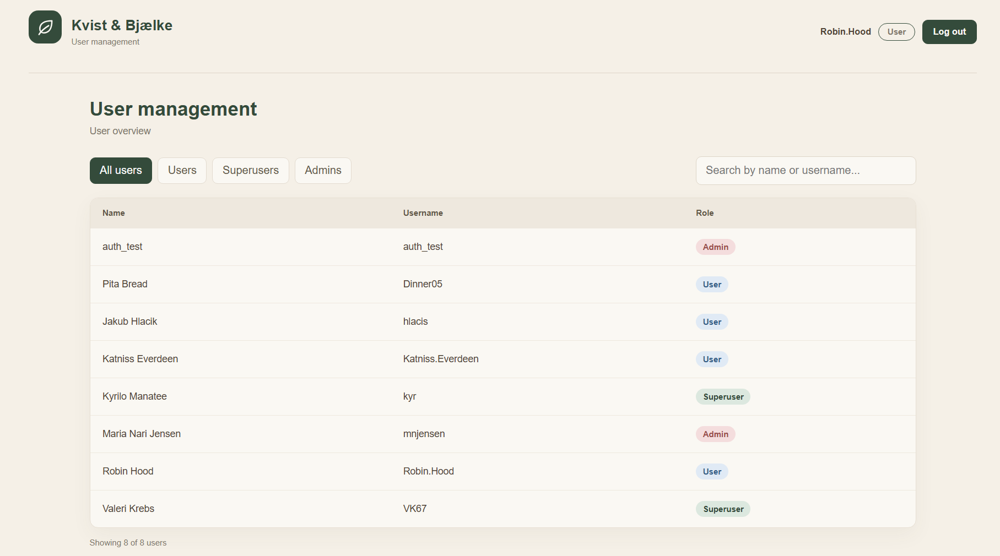

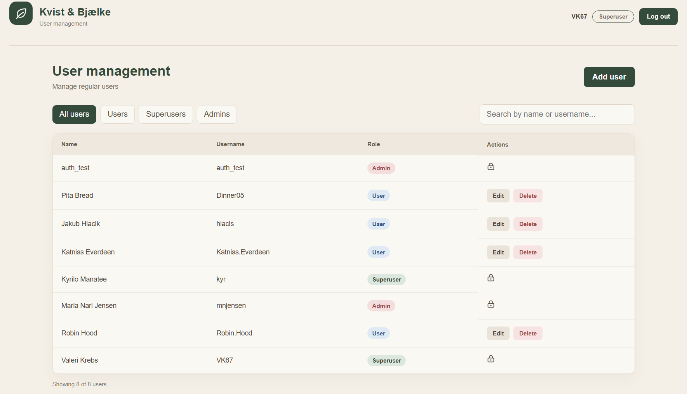

### 1.4 Security Decisions

Security has been considered throughout the development of the application.

Some of the main decisions include:

- Passwords are hashed instead of stored as plaintext.

- JWT is used for authentication.

- Role-based authorisation restricts access to protected endpoints.

- Temporary passwords are generated securely by the backend.

- Users must change their temporary password when logging in for the first time.

- Database connection strings and sensitive configuration values are not committed to GitHub.

These decisions help protect user accounts and limit unauthorised access to the application.

## Part 2 – CDS.infrastructure

Kvist & Bjælke ApS needs a structured network where employees, servers and other devices are separated logically. This part contains the IP addressing plan and subnetting for the whole company and the implemented part of the solution: the login platform running in Docker on a server in VLAN 571 and tested from a client in VLAN 570. Both virtual machines run on the school's Proxmox environment.

### 2.1 IP Addressing Plan

The company's devices are divided into 7 VLANs. VLAN 570 (clients) and VLAN 571 (servers) are given by the assignment, and the others follow the same pattern (10.5.\<VLAN\>.0/24) so the scheme is easy to read: the third octet is always the VLAN ID.

| **VLAN** | **Name**    | **Devices**                       | **Subnet**   | **Gateway** | **DHCP / Static**         |
|----------|-------------|-----------------------------------|--------------|-------------|---------------------------|
| 570      | Client      | 15 desktops, 10 laptops           | 10.5.70.0/24 | 10.5.70.5   | DHCP                      |
| 571      | Server      | 3 servers                         | 10.5.71.0/24 | 10.5.71.5   | Static                    |
| 572      | Printers    | 3 network printers                | 10.5.72.0/24 | 10.5.72.5   | Static / DHCP reservation |
| 573      | Voice       | 12 IP phones                      | 10.5.73.0/24 | 10.5.73.5   | DHCP                      |
| 574      | Management  | 4 access points, switches, router | 10.5.74.0/24 | 10.5.74.5   | Static                    |
| 575      | Cameras     | 6 surveillance cameras            | 10.5.75.0/24 | 10.5.75.5   | Static / DHCP reservation |
| 576      | Guest Wi-Fi | Visitors' phones and computers    | 10.5.76.0/24 | 10.5.76.5   | DHCP                      |

#### Why the networks are separated

- **Security:** The servers are not reachable from guest devices, cameras or printers, and a compromised device cannot easily reach the rest of the company.

- **Control:** The firewall can allow only the traffic that is needed between VLANs (for example clients to the login platform).

- **Performance:** Voice and video traffic does not compete with normal office traffic, and broadcast traffic stays inside each VLAN.

- **Management:** Network equipment is in its own VLAN, so only administrators can reach it.

#### Static addresses or DHCP

- Servers and network equipment use **static** addresses, because other devices must always find them at the same address.

- Computers, phones and guest devices use **DHCP**, because there are many of them and they change often.

- Printers and cameras use static addresses or DHCP reservations, so they keep the same address without manual configuration on every device.

### 2.2 Subnetting

All networks use a /24 prefix. The first 24 bits identify the network and the last 8 bits identify the host, so a subnet has 2^8 − 2 = **254 usable addresses** (the network address and the broadcast address cannot be used for hosts).

|                   | **VLAN 570 – Client**   | **VLAN 571 – Server**   | **VLAN 572 – Printers** |
|-------------------|-------------------------|-------------------------|-------------------------|
| Network address   | 10.5.70.0               | 10.5.71.0               | 10.5.72.0               |
| Subnet mask       | 255.255.255.0 (/24)     | 255.255.255.0 (/24)     | 255.255.255.0 (/24)     |
| Usable range      | 10.5.70.1 – 10.5.70.254 | 10.5.71.1 – 10.5.71.254 | 10.5.72.1 – 10.5.72.254 |
| Broadcast address | 10.5.70.255             | 10.5.71.255             | 10.5.72.255             |
| Usable hosts      | 254                     | 254                     | 254                     |
| Devices today     | 25 computers            | 3 servers               | 3 printers              |

The subnet sizes are more than large enough: VLAN 570 needs 25 addresses today and still has room for the company to grow almost ten times, including laptops and phones connected via Wi-Fi. The small networks (servers, printers) could have used much smaller subnets (for example /29 with 6 hosts for the printers), but we kept /24 everywhere. This keeps things simple, and each network has plenty of room to grow.

### 2.3 Server on VLAN 571

An Ubuntu Server virtual machine was created in Proxmox and connected to VLAN 571. Docker was installed, and the login platform runs in Docker containers.

| **Parameter**    | **Configuration**                                     |
|------------------|-------------------------------------------------------|
| Operating system | Ubuntu Server 26.04.1 LTS (kandb-server)              |
| Network          | VLAN 571, IP address 10.5.71.98/24, gateway 10.5.71.5 |
| Hosting          | Docker (Docker Compose)                               |
| Application port | **TCP 8080** (within the allowed range 8000–8100)     |

In the lab, the server received its address from DHCP. In a real deployment it would be given a fixed address, as in the IP plan above.

The platform is built from a multi-stage Dockerfile (the React frontend and the ASP.NET Core API are built into one image served on port 8080). compose.yaml starts the application together with a SQL Server container, because the school database could not be reached from VLAN 571. Passwords and keys are stored in a .env file on the server and are not committed to GitHub.

Server IP configuration (ip a):

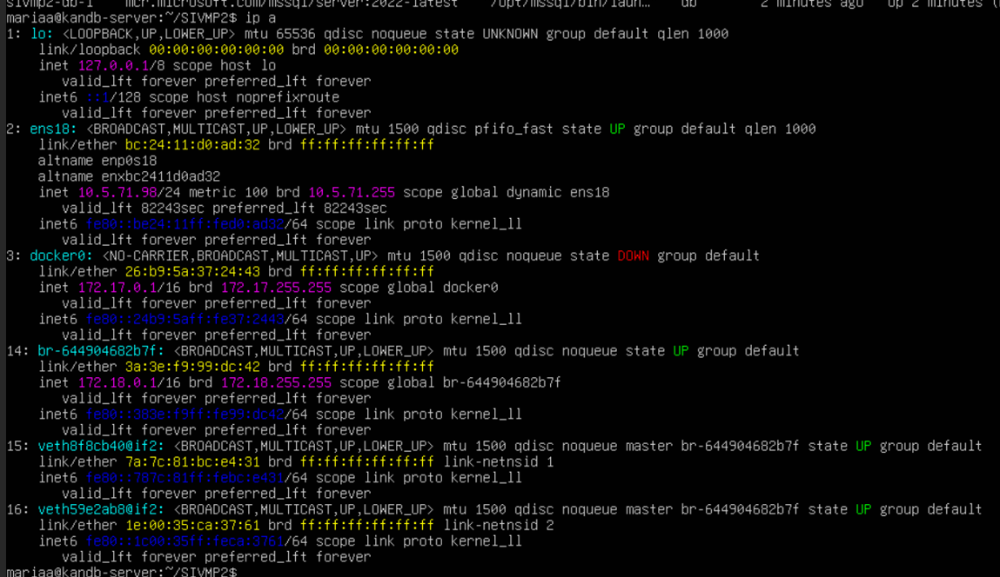

Docker installed and working (docker --version, docker run hello-world):

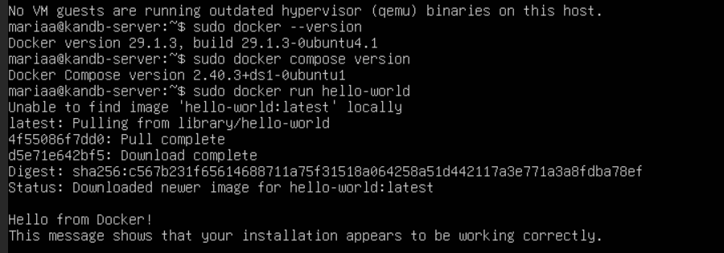

Login platform running in containers (docker compose ps):

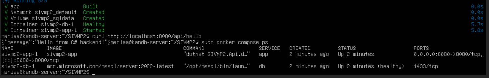

### 2.4 Client on VLAN 570

A second virtual machine was created as an employee client and connected to VLAN 570.

| **Parameter**    | **Configuration**                                     |
|------------------|-------------------------------------------------------|
| Operating system | Ubuntu Desktop 26.04.1 LTS (kandb-client)             |
| Network          | VLAN 570, IP address 10.5.70.98/24, gateway 10.5.70.5 |
| Purpose          | Accessing and testing the login platform in a browser |

The IP plan uses DHCP for clients, but there was no DHCP service in the lab's VLAN 570, so the client was given the static address above with nmcli. The ping to the gateway shows that the configuration is correct.

Client IP configuration (ip a) and ping to the gateway:

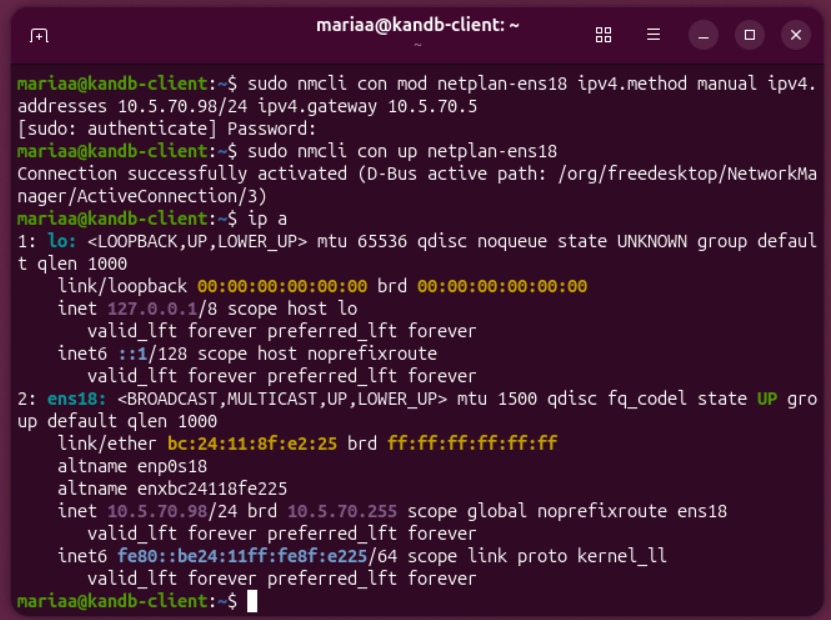

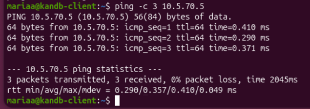

### 2.5 Firewall and Communication Between VLANs

The network firewall is already configured to allow traffic from VLAN 570 to VLAN 571 on TCP ports 8000–8100.

- **Why separate networks?** Clients and servers have different security needs. Separation limits what a compromised client can reach.

- **Why routing?** Devices in different subnets cannot talk directly to each other. The traffic has to go through the gateway (router), which forwards it between the VLANs.

- **Role of the firewall:** It decides which traffic is allowed between the networks, so only permitted connections get through.

- **Why specific ports?** Only the application port is open. Other services on the server cannot be reached from the clients, which reduces the attack surface.

The firewall behaviour was verified from the client: the connection to port 8080 succeeds (nc -zv 10.5.71.98 8080), while a ping to the server gets 100 % packet loss, because ICMP is not in the allowed traffic.

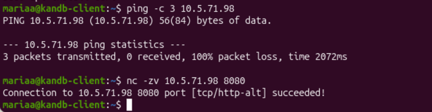

#### Client accessing the login platform

The login platform is opened from the client in Firefox at <http://10.5.71.98:8080>. The first admin logs in, is forced to change the password, and then creates a test user. This shows that the platform can be used from VLAN 570.

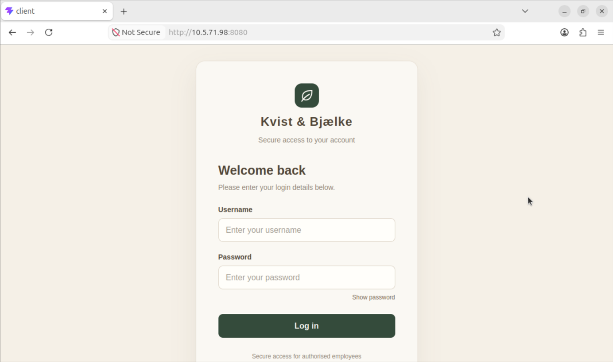

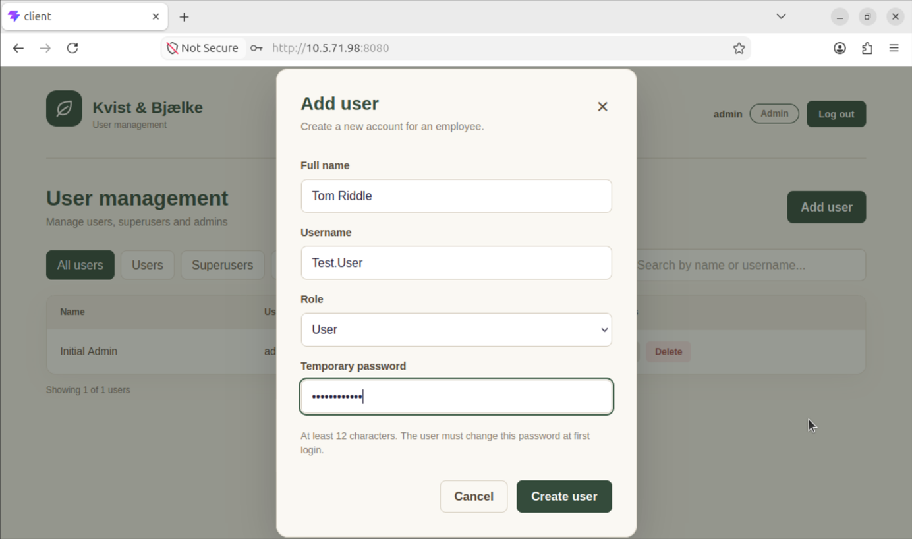

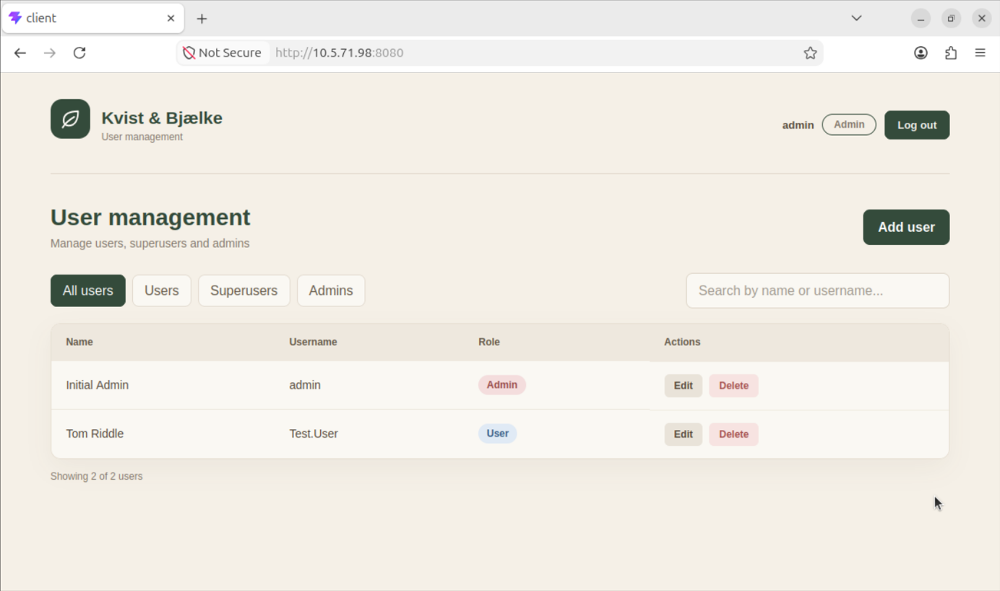

### 2.6 Challenges and Solutions

| **Challenge**                                                                           | **Solution**                                                                                                                |
|-----------------------------------------------------------------------------------------|-----------------------------------------------------------------------------------------------------------------------------|
| The Docker build failed because of unused variables in the frontend (TypeScript error). | The unused property was removed from the three components, and the build succeeded.                                         |
| The \# in the database password was read as a comment in .env.                          | The value was wrapped in single quotes.                                                                                     |
| The server in VLAN 571 could not reach the school database (No route to host).          | A SQL Server container was added to compose.yaml, and the API now creates the database and the first admin user at startup. |
| The server VM started the Ubuntu Desktop installer.                                     | The ISO in Proxmox was changed to the Ubuntu Server image.                                                                  |
| The Docker install script failed in the console.                                        | Docker was installed from the Ubuntu repositories with apt install docker.io docker-compose-v2.                             |
| The client got no IP address, and the gateway was unreachable.                          | There is no DHCP in VLAN 570, so a static address was set. The VLAN tag we had added in Proxmox was wrong and was removed.  |

## Part 3 – Final Reflection

This project gave us practical experience with both application security and IT infrastructure.

One of the most important things we learned was how closely security and infrastructure are connected.

Developing a secure login platform is not enough on its own. The application must also be hosted in a properly configured environment where access to the server and its services is controlled.

We gained experience with password hashing, JWT authentication, role-based authorisation, database management, Docker deployment, virtual machines, IP addressing and VLAN separation.

If the solution were deployed in a real company, further improvements could include HTTPS, regular security updates, database backups, monitoring and additional security testing.

Overall, the project helped us understand how a web application can be developed, secured and deployed as part of a company's IT infrastructure.

## Source Code

The source code for the project is available on GitHub:

https://github.com/hlacis/SIVMP2
